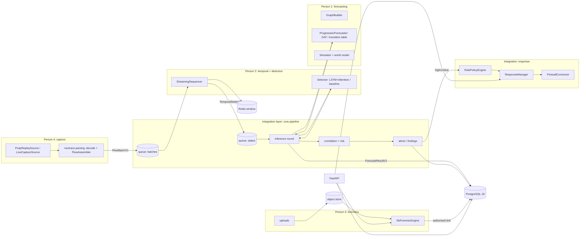

# Backend architecture

A **modular monolith**: one Python process type (`nextrace`), four owned modules plus an integration layer, in-process
bounded queues instead of a broker, PostgreSQL as the only system of record. Everything crosses module boundaries as a
versioned pydantic contract; nothing crosses as a table or a private class.

## 1. Shape

Why a monolith first: Fowler's monolith-first argument plus the practical observation that four people in parallel
manufacture integration problems faster than infrastructure can absorb them. Why no broker: the only producer that
can outrun a consumer is capture, and a bounded in-process queue with an explicit policy (block / shed oldest / reject)
gives backpressure with full visibility. A broker is deferred until a benchmark shows a single process cannot keep up
(the 2.5 Gbps figure is a benchmark target, not an assumption; nothing here has been measured at that rate).

## 2. Packages

| Package | Role | Owner |
|---|---|---|
| `nextrace/contracts/` | canonical models (`v1.py`, `observations.py`, `temporal.py`, `models.py`, `findings.py`, `forensics.py`, `response.py`, `ops.py`), ports (`ports.py`), errors | integration |
| `nextrace/core/` | `composition.py` (root), `pipeline.py` (orchestrator), `bus.py` (bounded queues), `auth.py`, `ratelimit.py`, `health.py`, `logging.py`, `ids.py`, `registry.py` | integration |
| `nextrace/modules/capture/` + `nextrace/parsing/` | sources, header decode, flow assembly | Person 4 |
| `nextrace/modules/temporal/` | event-time sequencer, state persistence | Person 2 |
| `nextrace/modules/detection/` + `nextrace/mlcommon/` | LSTM+Attention, training, calibration, detectors | Person 2 |
| `nextrace/modules/forecasting/` | graph builder, GAT, transition baseline, world-model template, Monte Carlo simulator | Person 1 |
| `nextrace/modules/correlation/` | correlator, risk scorer | integration |
| `nextrace/modules/explanation/` | SHAP, guard-railed LLM | integration |
| `nextrace/modules/findings/` | alerts, feedback, investigation updates | integration |
| `nextrace/modules/response/` | policy engine, connectors, lifecycle manager | integration |
| `nextrace/modules/forensics/` | uploads, jobs, rules, reports, linking | Person 3 |
| `nextrace/api/` | HTTP surface | integration |
| `nextrace/services/`, `nextrace/storage/`, `nextrace/db/`, `migrations/` | storage layer (see `docs/database/`) | integration |
| `nextrace/workers.py`, `nextrace/cli.py` | process entry points | integration |

## 3. Composition and dependency injection

`core.composition.build_context(settings, conn_factory, store, cache, overrides)` is the only place that instantiates
module classes. It returns an `AppContext` holding one implementation per port:

| Port | Default implementation | Chosen when |
|---|---|---|
| `Detector` | `TorchDetector` | `NEXTRACE_DETECTION_MODEL_SHA256` names a registered, loadable artifact |
|  | `HeuristicBaselineDetector` (kind `heuristic_baseline`) | no artifact and `NEXTRACE_HEURISTIC_BASELINE_ENABLED=true` |
|  | `UnavailableDetector` | otherwise; the pipeline records nothing and reports the gap |
| `ProgressionForecaster` | `TransitionTableForecaster` from a JSON artifact | `NEXTRACE_PROGRESSION_MODEL_SHA256` set |
|  | `UnavailableForecaster` | otherwise |
| `Simulator` | `MonteCarloSimulator` over the fitted transition model | always (reports `unavailable` without a model) |
| `Explainer` | `GuardedLLMExplainer(HttpProvider)` | `NEXTRACE_LLM_ENABLED=true` |
|  | `UnavailableExplainer` | otherwise (SHAP needs a trained torch detector plus a background set; wire via `overrides`) |
| `TemporalSequencer` | `StreamingSequencer` | always |
| `Correlator` / `RiskScorer` / `PolicyEngine` | in-memory correlator with seed patterns / weighted scorer / rule engine | always |
| `FirewallConnector` | `{"dry-run": DryRunConnector}` | always; real connectors are added through `overrides["connectors"]` |
| `ForensicEngine` | `DbForensicEngine` | always |

Tests pass `overrides` and a `savepoint_factory` so every component runs inside one rolled-back transaction.

## 4. Runtime processes

| Process | Command | What it runs |
|---|---|---|
| pipeline (replay) | `python -m nextrace.workers replay --pcap f.pcap --sensor-name S` | capture → states → inference → alerts over a fixture; live capture plugs in the same way once `LiveCaptureSource._reader` exists |
| API | `python -m nextrace.workers api` | FastAPI on 127.0.0.1:8000; `/docs` outside prod |
| forensics worker | `python -m nextrace.workers forensics` | pops queued jobs with `FOR UPDATE SKIP LOCKED` |
| maintenance | `python -m nextrace.workers maintenance` | delayed correlation matching, response expiry/removal; every minute |
| storage jobs | `python -m nextrace.cli ensure-partitions|retention|expire-actions|verify` | see `docs/database/` |

All processes share the database; the pipeline additionally keeps the bounded Redis window warm. They can later be
containerised one per process without code changes because every dependency is environment-driven.

## 5. Asynchronous workers and backpressure

`Pipeline.run` starts three coroutines: a producer draining the capture source into `queue.batches`, a batch consumer
(flows → persisted flows → sequencer → persisted states → cache → `queue.states`), and a state consumer (inference
round per closed state). DB work runs in threads (`asyncio.to_thread`) so a slow model never blocks the event loop.
Queue policy comes from `NEXTRACE_BACKPRESSURE_POLICY`; every shed or rejected item is counted and visible in
`/health` under `queue.*`. Live capture sources use `shed_oldest` on their own ring so the kernel buffer is drained
regardless of consumer speed, and count what they shed.

## 6. What is real and what is a template

Real and tested: contracts, queues, sequencer, parser, replay source, baseline detector, LSTM+Attention model and
training script, calibration, GAT layer (shapes), transition baseline, Monte Carlo simulator, correlator, risk scorer,
policy engine, response lifecycle with verification, forensic engine with three rule analyses, API, auth, audit.

Templates (typed, refuse to pretend): `LiveCaptureSource._reader`, `TorchGATForecaster`, `RSSMWorldModel`,
`NftablesConnector`, `ShapExplainer` (real code, needs a trained detector and background rows), SHAP/LLM wiring in
composition. See `implementation-status.md`.
