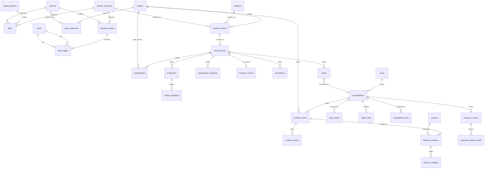

# Schema: entities, relationships, data dictionary, contracts

The authoritative definition is `migrations/sql/0001_initial.sql`. This document explains it.

## 1. Entity-relationship diagram



Cardinalities worth stating: one temporal state per (sensor, window start, window length); a state has
0..n edges (one per ordered host pair active in the window); a forecast run consumes 1..n states and
produces 0..n predictions (one per input state), 0..n progression steps, 0..n explanations; a case has
0..n grants per user (history), 0..n evidence items each with 1..n custody events; a response action has
exactly one event per transition.

## 2. Data dictionary

Column types are PostgreSQL types. "Sensitivity": P = personal/network-identifying (IP addresses, user
ids), E = evidence (legal weight), S = secret-derived (hashes of secrets), – = none.

### Registry

| Table | Key columns and constraints | Indexes | Sensitivity | Lifecycle |
|---|---|---|---|---|
| `sensors` | `sensor_id` uuidv7; `name` unique; `kind` ∈ zeek/suricata/ndr/live_capture/pcap_upload; `config` jsonb | name | – | permanent |
| `users` | `username` `^[a-z0-9_.-]{3,64}$`; `role` ∈ viewer/analyst/dfir/admin/service; `api_key_hash` bytea(32), unique (raw key never stored); `active` | username, api_key_hash | S | permanent |
| `feature_schemas` | (`name`,`version`) unique; `definition` jsonb ordered list; `definition_sha256` | | – | permanent |
| `objects` | `sha256` PK bytea(32); `size_bytes`; `media_type`; `kind` ∈ pcap/upload/model/shap/artifact/export/report; `storage_path` relative; `last_verified_at`, `verify_ok`; `deleted_at` tombstone | | E (path hidden from readonly role) | bytes reclaimable; row permanent |
| `datasets` | (`name`,`version`) unique; → objects, feature_schemas; `row_count` | | – | permanent |
| `model_versions` | (`name`,`version`) unique; `kind` ∈ lstm_attention/gnn/llm/other; → objects (artifact), feature_schemas, datasets; `hyperparameters`, `metrics` jsonb; `status` candidate/active/retired | | – | permanent |

### Telemetry

| Table | Key columns and constraints | Indexes | Sensitivity | Lifecycle |
|---|---|---|---|---|
| `hosts` | `ip` inet unique; `pseudonym` bytea(32) unique (HMAC-SHA256); `first_seen`, `last_seen`; `asset_tag`, `zone` | ip, pseudonym | P | permanent (pruning TBD) |
| `pcap_segments` | → sensors, objects; `capture_kind` headers/full/upload; `snaplen`, `link_type`; `ts_first ≤ ts_last`; `packet_count`; `status` active/held/reclaimed; `hold_count ≥ 0` | (sensor, ts_first); partial (created_at) where active | E | age or budget FIFO; held never |
| `ingest_batches` | → sensors; `source` ∈ zeek_conn/suricata_eve/pcap/csv/api; `accepted`, `rejected`; `status` received/loaded/failed | | – | permanent (provenance) |
| `flows` (partitioned by day on `ts_start`) | PK (`flow_id`, `ts_start`); → sensors, ingest_batches, pcap_segments, feature_schemas; `src_ip`/`dst_ip` inet; ports 0–65535; `proto` 0–255; `duration_ms ≥ 0`; byte/packet counters ≥ 0; `ts_end ≥ ts_start`; `features real[]` paired with `feature_schema_id`; `label` ground truth or NULL; `community_id` | BRIN(ts_start); (sensor_id, ts_start); (src_ip, ts_start); (dst_ip, ts_start); partial (community_id) | P | 183-day partition drop; hold veto |
| `temporal_states` (partitioned by day on `window_start`) | PK (`state_id`, `window_start`); unique (`sensor_id`, `window_start`, `window_seconds`); `schema_version`; counters `n_flows`, `n_nodes`, `n_edges`, `total_bytes`, `total_pkts`; `summary` jsonb; `features real[]` NOT NULL + `feature_schema_id` | BRIN(window_start) | – | 183-day partition drop |
| `state_edges` (partitioned by day) | PK (`state_id`, `window_start`, `src_host_id`, `dst_host_id`); FK (state_id, window_start) → temporal_states ON DELETE CASCADE; `n_flows > 0`; `bytes`, `pkts`, `dst_ports`; `features real[]` | (src_host_id, window_start); (dst_host_id, window_start) | P (via host ids) | 14-day partition drop |

### Forecasting

| Table | Key columns and constraints | Indexes | Sensitivity | Lifecycle |
|---|---|---|---|---|
| `forecast_runs` (append-only) | → sensors, model_versions (×2); `input_state_ids uuid[]` non-empty; `input_window_start ≤ end`; `input_sha256`; `horizon_seconds > 0`; `started_at ≤ completed_at`; `status` completed/failed; `error` | (sensor_id, created_at desc); (created_at) | – | 365 days if unreferenced; retention job only |
| `predictions` (append-only) | → forecast_runs; `state_id`, `window_start`; `is_malicious`; `probability` 0–1; `category`, `attack_stage`; `technique_ids text[]` each `^T\d{4}(\.\d{3})?$` | (run_id); (state_id) | – | with run |
| `progression_forecasts` (append-only) | → forecast_runs, simulations (NULL = baseline), hosts; `step ≥ 1`; `predicted_technique_id` ATT&CK format; `predicted_tactic`; `probability`; `expected_within_s` | (run_id, step) | – | with run |
| `explanations` (append-only) | → forecast_runs, predictions, model_versions, objects (`artifact_sha256`); `kind` shap/llm; `content` jsonb (pseudonymised hosts only); `prompt_sha256`; `disclaimer` default "Explanation of model output. Not evidence that an attack occurred." | (run_id) | – | with run |
| `simulations` | → forecast_runs (base), users, objects; `scenario` jsonb; `status` | | – | with run |
| `forecast_current` | PK `sensor_id`; → forecast_runs; `updated_at` | | – | overwritten |
| `analyst_feedback` | → predictions, users; `verdict` ∈ true_positive/false_positive/benign_anomaly/unknown; `eligible_for_training` default false | | – | permanent |

### Post-detection workflow

| Table | Key columns and constraints | Indexes | Sensitivity | Lifecycle |
|---|---|---|---|---|
| `alerts` | → forecast_runs, predictions, sensors, users (assigned), investigations; `severity`; `status` new/acknowledged/escalated/closed | partial (created_at) where open | – | permanent (TBD) |
| `investigations` | `case_number` `^[A-Z0-9-]{4,32}$` unique; `severity`; `status` open/in_progress/closed; → users (opened_by) | case_number | – | permanent |
| `investigation_links` | PK (case, `object_type`, `object_id`); `object_type` ∈ alert/forecast_run/temporal_state/host/flow/forensic_finding/response_action/upload; → users | | – | with case |
| `case_grants` | → investigations, users (×2); `access_level` metadata/full_pcap; `expires_at > granted_at`; `revoked_at`; `reason ≥ 8 chars`; CHECK `granted_by <> user_id` | partial (case, user) where not revoked | – | history kept |
| `evidence_items` | → investigations, objects, sensors, users; `kind` ∈ pcap_slice/flow_export/state_export/artifact/report/upload; `description`, `acquisition_method` NOT NULL; `ts_first ≤ ts_last` | (investigation_id) | E, P | permanent |
| `custody_events` (append-only) | → evidence_items, users; `action` ∈ acquired/verified/accessed/exported/transferred/released; `hash_verified`; `details` jsonb | (evidence_id, at) | E | permanent |
| `legal_holds` | → investigations, sensors, users (×3); `scope_start < scope_end`; `host_ips inet[]`; `reason`; `status` pending/preserved/released; CHECK `requested_by <> approved_by` | partial (scope) where not released | E | permanent |
| `uploads` | → users, investigations, objects; `original_filename` `^[A-Za-z0-9._ -]{1,200}$`; `media_type` allow-list; `size_bytes > 0`; `status` | | P | with case (TBD) |
| `forensic_analyses` | → investigations, uploads, evidence_items, users, objects; CHECK upload or evidence present; `params`, `summary` jsonb; `status` | | – | with case |
| `forensic_findings` | → forensic_analyses, objects; (`analysis_id`,`seq`) unique; `ts`; `src_ip`/`dst_ip`; `technique_id` ATT&CK format; `confidence` 0–1 | | P | with analysis |
| `response_actions` | → investigations, alerts, forecast_runs, users (proposed_by, authorized_by); `action_type` ∈ block_ip/block_pair/rate_limit/isolate_host; `target` inet (host or CIDR); `peer`, `port`, `direction`; `enforcement_point`; `justification ≥ 8`; `status` (11 states, trigger-enforced machine); `expires_at > proposed_at` NOT NULL; `verification_method` ∈ rule_readback/probe/traffic_observation/manual; `enforced` **virtual generated** = (status = 'verified'); CHECK authorizer ≠ proposer | partial (expires_at) where live; (target) | P | permanent |
| `response_action_events` (append-only) | → response_actions, users; `from_status`, `to_status`; `details` | (action_id, at) | – | permanent |
| `audit_log` (append-only, hash-chained) | identity PK; `actor_id`, `actor_label`; `action` `^[a-z_.]{3,64}$`; `object_type`, `object_id`; `details` jsonb; `client_ip`; `prev_hash`, `entry_hash` (sha256 over prev + canonical fields, computed in a BEFORE INSERT trigger under an advisory lock) | (at); (object_type, object_id) | – | 730 days, retention job only |

### Response action state machine (enforced by `nt_response_action_transition`)

```
proposed ─▶ authorized ─▶ executing ─▶ executed ─▶ verified ─▶ expired ─▶ removed ─▶ removal_verified
   │            │             │            │           │
   ▼            ▼             ▼            ▼           ▼
rejected     rejected       failed   verification_failed ─▶ executing (retry) | failed
                                                     verified ─▶ removed (early manual removal)
```

Required fields per transition: `authorized` needs `authorized_by` + `authorized_at`; `executed` needs
`executed_at`; `verified`/`verification_failed` need `verified_at`, `verification_method`,
`verification_result`; `removed` needs `removed_at`; `removal_verified` needs `removal_verified_at`.
Terminal states (`rejected`, `failed`, `removal_verified`) reject any further update. Proposal fields and
`authorized_by` are write-once.

## 3. Versioned contracts (`nextrace/contracts/v1.py`)

All contracts carry `version: 1`, forbid unknown fields, require timezone-aware timestamps, and are the
only path into SQL. A breaking change creates `v2.py`; both versions are accepted during migration and the
`version` field routes them.

| Contract | Producer → consumer | Validation rules beyond types |
|---|---|---|
| `FlowRecordV1` | sensor adapter → `ingest_flows` | `ts_end ≥ ts_start`; `ts_start ≤ now + 5 min`; ports 0–65535; proto 0–255; `service` `^[a-z0-9_,.-]{1,32}$`; `conn_state` `^[A-Z0-9]{1,8}$`; `history` `^[A-Za-z^]{1,64}$`; `community_id` `^\d+:[A-Za-z0-9+/]{27}=$`; `features` (≤ 512) iff `feature_schema_id`; `label` `^[A-Za-z0-9 _:-]{1,64}$` |
| `TemporalStateV1` | state builder → cache / engine | window 1–3600 s; counters ≥ 0; features ≤ 512 |
| `PredictionV1` | engine → `record_run` | probability 0–1; technique ids ATT&CK format, ≤ 32 |
| `ProgressionStepV1` | engine → `record_run` | step 1–64; technique id format; tactic `^[a-z-]{3,48}$` |
| `ExplanationV1` | engine → `record_run` | kind shap/llm; `prediction_index` must exist; hashes are 64 hex chars |
| `ForecastResultV1` | engine → `record_run` | `completed_at ≥ started_at`; window ordered; failed ⇒ error present; completed ⇒ no error; ≤ 4096 states/predictions |
| `ResponseActionProposalV1` | UI/system → `propose` | `expires_at` in the future; `block_pair` needs `peer`; `enforcement_point` `^[A-Za-z0-9_.:-]+$`; justification 8–2000 chars |
| `VerificationResultV1` | firewall connector → `record_verification` | method ∈ rule_readback/probe/traffic_observation/manual; `enforced` boolean; observed evidence dict |
| `EvidenceManifestV1` | DFIR tools → `add_evidence` | sha256 hex; media type pattern; kind allow-list |
| `LiveEventV1` | cache → WebSocket | ids and counters only, no payload bytes |

## 4. Unresolved decisions (research required)

| Decision | Current default | What would settle it |
|---|---|---|
| Temporal state window length and whether states should overlap | 10 s fixed windows, stored per row | Model-team sweep on the deployment's traffic (the literature's best windows range from 5 s to 2 h) |
| State and edge feature sets | 10 window features, 5 edge features (`WINDOW_FEATURES_V1`, `EDGE_FEATURES_V1`) | Chosen model inputs; register as new `feature_schemas` versions |
| Whether the GNN consumes snapshots (`state_edges`) or a continuous event stream (`flows`) | Both are stored; edges kept 14 days | Model selection (snapshot models like DySAT/EvolveGCN vs. TGN/TGAT) |
| Edge cardinality at scale | Unbounded per window | Measure edges/window on real traffic; cap or sample if > ~10⁴ |
| Progression model input (technique sets vs. host graphs) | Technique ids stored per prediction; host target per step | Model choice between TIE-style recommenders and graph models |
| Flow retention at the 2.5 Gbps target | 183 days in PostgreSQL | Measured flow rate; above ~2 000 flows/s sustained, plan a columnar cold tier |
| Retention of orphaned uploads, closed-case alerts, inactive hosts | keep | Legal/compliance decision |
| Recovery point/time objectives | ~1 min DB loss window | Operations decision |
